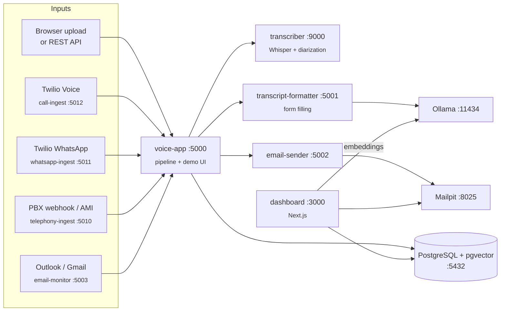

<div align="center">

# AI Calling Assistant

**A local-first support pipeline that transcribes customer calls, fills in an incident form with a local LLM, emails it to the support team and stores it.**


</div>

A group project from Year 2 of the IT programme at NHL Stenden. Support agents spend a lot of time typing up calls. This system takes the recording of a support call (or a WhatsApp voice note, or an email), transcribes it with speaker separation, has a local LLM extract the incident details into a structured form, emails the completed form to the support team, and stores everything in PostgreSQL. A Next.js dashboard lets staff browse incidents, search transcripts and export a form to Word.

Everything runs locally in Docker. Audio and transcripts never go to a cloud AI service: speech-to-text uses Whisper and form filling uses a model served by Ollama on your own machine.

## Features

- **Speech-to-text with speakers.** [faster-whisper](https://github.com/SYSTRAN/faster-whisper) transcription plus diarization (SpeechBrain speaker embeddings and clustering) to separate agent and caller.
- **AI form filling.** The transcript formatter prompts a local Ollama model to fill in a fixed incident form schema, with confidence scoring, a profanity filter, PII filtering on chosen fields and an optional Dutch translation.
- **Email dispatch.** Completed forms are sent over SMTP. In development, [Mailpit](https://mailpit.axllent.org) catches every message so nothing is delivered for real.
- **Many ways in.** Browser upload and recording, a REST API, Twilio Voice calls, Twilio WhatsApp messages and voice notes, PBX recording webhooks (with an Asterisk AMI listener and a FreePBX lab), and email from Gmail or Outlook.
- **Dashboard.** Overview, incidents, calls, a unified inbox (Mailpit, Outlook, Gmail), semantic transcript search with pgvector, Word export, user accounts with roles, and live service health.
- **GPU optional.** Runs on CPU everywhere; a start script detects a usable NVIDIA GPU and switches to GPU mode for Whisper and Ollama.

## How it works



`voice-app` runs the pipeline for every input: transcribe, extract the form, send the email, save the result. The ingest services only adapt their channel (download the recording, verify the Twilio signature or webhook token) and forward the audio to `voice-app`'s `/upload` endpoint.

## Getting started

### Prerequisites

- Docker Desktop (Windows, macOS) or Docker Engine with the Compose plugin (Linux)
- Disk space for the models. The defaults in `.env.example` are `gemma3:12b` for Ollama and `large-v2` for Whisper, which are several GB each; pick smaller ones in `.env` if needed.
- Optional, for GPU mode: an NVIDIA GPU with current drivers, plus WSL2 GPU support on Windows or the NVIDIA Container Toolkit on Linux.

### Start the stack

```bash
git clone https://github.com/AlexMakesC0de/AI-calling-assistant.git
cd AI-calling-assistant
cp .env.example .env           # Windows PowerShell: Copy-Item .env.example .env
./scripts/start-stack-auto.sh  # Windows PowerShell: ./scripts/start-stack-auto.ps1
docker compose ps
```

The start script checks for a usable NVIDIA GPU and runs the stack in GPU or CPU mode with the `dev` profile (which adds Mailpit). Use `--dry-run` (PowerShell: `-DryRun`) to see what it would do. To choose yourself:

```bash
docker compose --profile dev up -d --build                                            # CPU
docker compose -f docker-compose.yml -f docker-compose.gpu.yml --profile dev up -d --build  # NVIDIA GPU
```

On macOS, CPU Ollama in Docker is slow. `docker-compose.native-ollama.yml` points the stack at an Ollama running natively on the host instead (see the comments in that file).

The `ollama-init` container pulls `OLLAMA_MODEL` on first start, and the transcriber downloads the Whisper model on first use, so the first run takes a while. Models are cached under `local-storage/`.

### Check that it works

1. Open the demo UI at `http://localhost:5000`, then upload a short call recording or record one in the browser.
2. Open Mailpit at `http://localhost:8025` and check that the incident email arrived.
3. Or use the API:

```bash
curl -sS -X POST http://localhost:5000/upload \
  -F "file=@test_call.wav" \
  -F "caller_name=Jane Doe" \
  -F "account_or_reference=AC-1234" \
  -F "contact_info=jane@example.com"
curl -sS http://localhost:5000/forms
```

Only `file` is required. [TESTING.md](TESTING.md) has the full test matrix and ways to record a test file.

### Run the dashboard

The dashboard needs `AUTH_SECRET` (signs login sessions) and `ENCRYPTION_KEY` (32 bytes, base64, encrypts stored mailbox tokens). The compose file does not pass these to the dashboard container yet, so run it on the host while the stack is up:

```bash
cd dashboard
cp .env.example .env           # fill in AUTH_SECRET and ENCRYPTION_KEY
npm install
node scripts/seed-admin.mjs    # creates the first admin account; change its password after logging in
npm run dev                    # http://localhost:3000
```

See [dashboard/README.md](dashboard/README.md) for the pages, semantic search setup and the Outlook connection.

### Stop

```bash
docker compose --profile dev down       # stop
docker compose --profile dev down -v    # stop and remove named volumes
```

Model and app data live in `local-storage/` on the host; delete that folder for a full reset.

## Configuration

All settings live in `.env`; [`.env.example`](.env.example) documents every value. The main groups:

| Area | Variables |
| --- | --- |
| Database | `POSTGRES_USER`, `POSTGRES_PASSWORD`, `POSTGRES_DB`, `VOICE_APP_DATABASE_URL` |
| LLM | `OLLAMA_MODEL`, `OLLAMA_URL`, `OLLAMA_READ_TIMEOUT`, `DEFAULT_INCLUDE_DUTCH_TRANSLATION` |
| Transcription | `WHISPER_MODEL`, `WHISPER_DEVICE`, `WHISPER_COMPUTE_TYPE`, `NUM_SPEAKERS` |
| Filtering | `TERM_FILTER_MODE`, `TERM_FILTER_CUSTOM_WORDS`, `OUTPUT_FILTER_PII_FIELDS` |
| Email out | `SMTP_HOST`, `SMTP_PORT`, `SMTP_USER`, `SMTP_PASSWORD`, `SMTP_FROM`, `SUPPORT_EMAIL` |
| Telephony | `TELEPHONY_WEBHOOK_TOKEN`, `RECORDING_AUTH_HEADER`, `RECORDING_AUTH_VALUE`, `AMI_*`, `PBX_*` |
| Twilio | `TWILIO_ACCOUNT_SID`, `TWILIO_AUTH_TOKEN`, `TWILIO_WHATSAPP_FROM`, `CALL_PUBLIC_BASE_URL`, `WHATSAPP_PUBLIC_BASE_URL` |
| Email in | `OUTLOOK_TENANT_ID`, `OUTLOOK_CLIENT_ID`, `OUTLOOK_CLIENT_SECRET`, `OUTLOOK_MAILBOX`, `GOOGLE_CLIENT_ID`, `GOOGLE_CLIENT_SECRET` |

The default passwords in `.env.example` are for local development only. Change them before exposing any port beyond your machine.

The formatter reads `OLLAMA_MODEL` on every request. To switch models, pull the new one (`docker exec -it support-ollama ollama pull <model>`), change `.env` and run `docker compose up -d transcript-formatter`.

## Services and ports

| Service | Port | Purpose |
| --- | --- | --- |
| `voice-app` | 5000 | Pipeline orchestration, demo UI, `/upload` and `/forms` API |
| `transcript-formatter` | 5001 | Incident form extraction with Ollama |
| `email-sender` | 5002 | SMTP dispatch |
| `email-monitor` | 5003 | Watches an Outlook inbox and classifies emails |
| `telephony-ingest` | 5010 | PBX recording webhook adapter |
| `whatsapp-ingest` | 5011 | Twilio WhatsApp webhook |
| `call-ingest` | 5012 | Twilio Voice webhook |
| `transcriber` | 9000 | Whisper transcription and diarization |
| `ollama` | (internal) | Local LLM runtime |
| `database` | 5432 | PostgreSQL 16 with pgvector |
| `dashboard` | 3000 | Next.js dashboard |
| `pgAdmin` | 8080 | Database admin UI |
| `n8n` | 5678 | Optional workflow automation |
| `mailpit` (dev profile) | 8025, 1025 | Test inbox and SMTP catch-all |

## Project structure

```text
voice-app/              Pipeline orchestration and demo UI (Flask)
transcriber/            Whisper and diarization service
transcript-formatter/   LLM form extraction, filters, prompt benchmark
email-sender/           SMTP service
email-monitor/          Outlook (Graph or IMAP) inbox watcher
call-ingest/            Twilio Voice handler
whatsapp-ingest/        Twilio WhatsApp handler
telephony-ingest/       PBX webhook adapter and Asterisk AMI listener
dashboard/              Next.js 15, Prisma and shadcn/ui dashboard
database/initDb/        SQL schema and seed scripts
templates/              Incident form schema and Word templates
scripts/                Start scripts, Word generation, audio mixing, test helpers
telephony-lab/          Seed files for a local FreePBX lab
n8n-workflows/          Optional n8n workflow
```

## Tests

Several services have pytest suites (`transcriber`, `transcript-formatter`, `voice-app`, `whatsapp-ingest`, `scripts/generate_word`). Install the shared test dependencies and run one:

```bash
pip install -r requirements-dev.txt
pytest transcript-formatter/tests
```

## More guides

- [TESTING.md](TESTING.md): end-to-end test matrix
- [TELEPHONY_SETUP.md](TELEPHONY_SETUP.md): PBX and telephony setup
- [docs/EMAIL_INGEST_SETUP.md](docs/EMAIL_INGEST_SETUP.md): Gmail IMAP and Outlook Graph ingest
- [GRAPH_EMAIL_READ.md](GRAPH_EMAIL_READ.md): connecting Outlook through a Microsoft Entra app
- [dashboard/README.md](dashboard/README.md): dashboard setup and pages

## License

This repository has no license file, so all rights are reserved by its authors.
